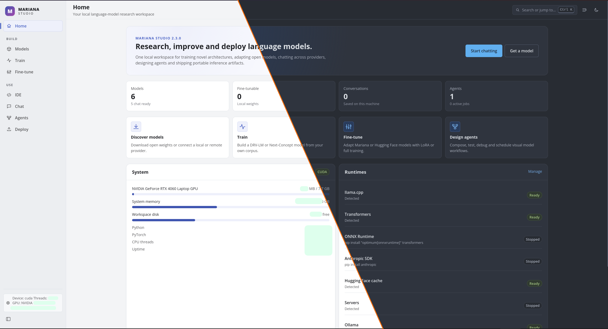

<!-- Banner: replace this comment with the banner image once it is ready.
<p align="center">
  
</p>
-->

# Mariana

*Into The Depths of AI's Ocean*

Mariana is a **one-stop research and development studio for language models**.
Train a compact byte-level hybrid diffusion–autoregressive model from scratch,
fine-tune local or Hugging Face checkpoints, chat with anything you can run,
build and schedule agents, code in an agentic IDE, evaluate, and export to GGUF,
ONNX or safetensors — from one local workspace.

Research you can run: every technique ships with a whitepaper, a runbook and
the code that implements it.

## Why Mariana

- **One workspace** — data, training, fine-tuning, chat, agents, IDE, evaluation
  and deployment behind a single local UI.
- **Research with receipts** — Sprint-DRV, SAINT, NCM and AML/AMP each have a
  dedicated whitepaper and runbook.
- **Small-GPU friendly** — automatic CUDA → Intel XPU → Apple MPS → CPU
  selection; measured up to 5.57× training throughput at ~61% less peak memory
  on an 8 GB consumer GPU.
- **Portable models** — lossless AR export to GGUF, ONNX and safetensors, ready
  for llama.cpp, Ollama or ONNX Runtime.
- **Local-first agents** — AML/AMP agent flows, swarms, schedules and a coding
  IDE with sandboxed abilities.

## Backed by whitepapers

| Paper | What it covers |
| --- | --- |
| [Sprint-DRV](docs/whitepapers/sprint-drv.md) | Single-pass hybrid training: one backbone forward for prefix-AR, diffusion, verifier and MTP, with the legacy two-pass baseline and measured throughput/memory. |
| [SAINT](docs/whitepapers/saint.md) | Adaptive hierarchical discrete/continuous thought memory: curricula, policy learning, ablations and honest limits. |
| [NCM](docs/whitepapers/ncm.md) | Multiscale residual VQ and parallel next-concept generation. |
| [AML and AMP](docs/whitepapers/aml-amp.md) | The portable agent document language and local HTTP/JSON runtime protocol. |

Each paper is a technical report for code in this repository; every measurement
states the hardware and protocol that produced it.

## One studio, the whole workflow

| Workspace | What it does |
| --- | --- |
| **Home** | Live GPU, memory, disk and job telemetry, recent work and quick actions. |
| **Models** | Discover and download checkpoints, GGUF/ONNX models, Hugging Face repos, Ollama and llama.cpp models, and OpenAI-compatible endpoints. |
| **Train** | Corpus inspection, Smart Options, Sprint-DRV/Legacy/NCM training, live loss, pause/save and a direct handoff to Chat. |
| **Fine-tune** | LoRA, final-layer or full fine-tuning for Mariana and Hugging Face models, with dataset discovery and a validated plan. |
| **Chat** | Persistent streaming chats with local or remote models, images and file previews, dictation, a context meter, and a leader-planned agent swarm or Solo mode. |
| **Agents** | Canvas-first AML/AMP agent designer with debugger, schedules, templates and live runs. |
| **IDE** | Agentic coding in project workspaces with skills, diagnostics, snapshots, revert and Ask/Edit/Auto modes. |
| **Deploy** | GGUF/ONNX/safetensors export, Ollama registration and an OpenAI-compatible local API. |

## Quick start

```bash
python -m venv venv && source venv/bin/activate
pip install -r requirements.txt

python mariana.py                          # smoke-test train on the built-in demo corpus
python -m mariana train --data corpus.txt  # train on your own text
python mariana.py studio                   # open the studio
```

Device selection is automatic — **CUDA → Intel XPU → Apple MPS → CPU** — with
per-device mixed precision; `--device cuda|xpu|mps|cpu` overrides. Smaller
CPU-only and Intel Arc installs use `requirements-cpu.txt` and
`requirements-xpu.txt`. **No checkpoints ship with the repository**;
`trained-model/` is created on demand and is git-ignored.

## Export

```bash
pip install -r requirements-export.txt
python -m mariana export --checkpoint trained-model/mariana.pt --format all --out exports
```

One command writes a LLaMA-architecture GGUF, an Ollama `Modelfile`, an ONNX
model and LLaMA-format safetensors. The AR path is lossless by construction and
verified by a numeric parity test. Runner commands and caveats are in
[docs/export.md](docs/export.md).

## Go deeper

| Topic | Read |
| --- | --- |
| Train, fine-tune or distill | [README_training.md](README_training.md) · [docs/distillation.md](docs/distillation.md) |
| Sprint-DRV, SAINT and NCM runbooks | [docs/fast-training.md](docs/fast-training.md) · [docs/latent-language.md](docs/latent-language.md) · [docs/ncm.md](docs/ncm.md) |
| Agents and the coding IDE | [docs/agentic.md](docs/agentic.md) · [docs/ide.md](docs/ide.md) |
| Export and serve | [docs/export.md](docs/export.md) |
| MoE + MTP + SAINT on a small GPU | [docs/low-vram.md](docs/low-vram.md) |
| Architecture and engineering standard | [architecture.txt](architecture.txt) · [AGENTS.md](AGENTS.md) |

The full index is [docs/README.md](docs/README.md).

## Tests

```bash
python -m pytest -q                 # complete CPU suite
python -m pyflakes mariana tests    # unused imports and undefined names
```

Optional backends skip cleanly when their packages are not installed.

## License and citation

Mariana is licensed under **AGPL-3.0**; see [LICENSE](LICENSE). If you use it in
your work, cite [CITATION.cff](CITATION.cff). Contributions follow
[CONTRIBUTING.md](CONTRIBUTING.md); security reports follow
[SECURITY.md](SECURITY.md).
